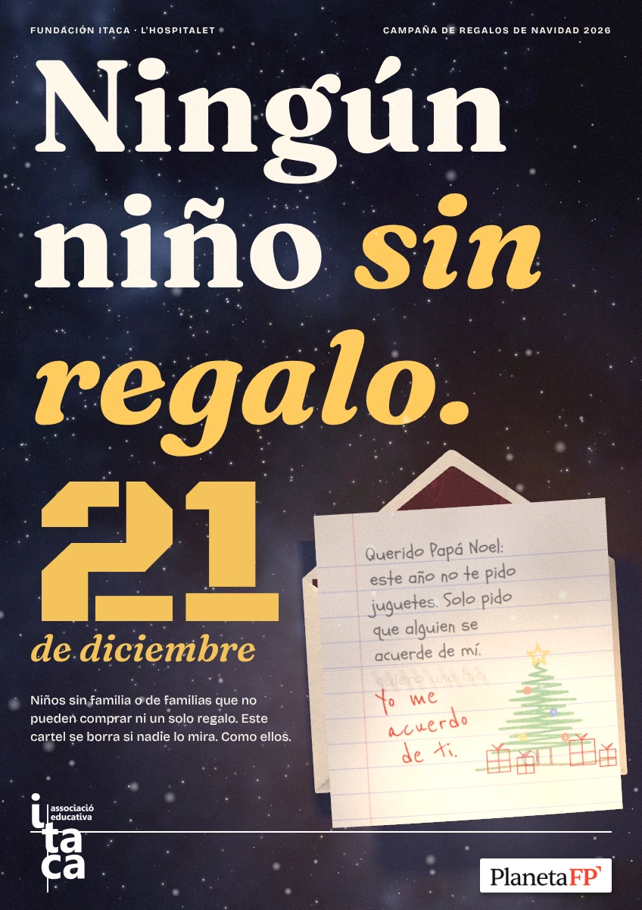

# El cartel que se olvida · Fundación ITACA · 21 de diciembre

Actividad 0612 · Desarrollo web en entorno cliente. Cartel digital interactivo de 848 × 1200 px hecho con HTML, CSS y JavaScript. Usa [three.js](https://threejs.org) (r149) para el sobre y la carta en 3D y como ayuda para WebGL; los shaders, la nieve, la animación del sobre y las interacciones están escritos a mano.



## Concepto

El cartel pide un donativo para comprar regalos de Navidad a niños sin familia o de familias que no pueden comprar ni un solo regalo.

El mensaje grande dice: **ESTA NAVIDAD HAY NIÑOS QUE SOLO PIDEN QUE ALGUIEN SE ACUERDE DE ELLOS.** Debajo hay un sobre cerrado con lacre, con «Para Papá Noel» escrito a lápiz con letra de niño. Dentro está su carta: una hoja de libreta arrancada de la espiral y doblada por la mitad, escrita a lápiz y con un árbol dibujado con ceras sin ningún regalo debajo. Se adivina lo que el niño escribió primero y borró: «quiero una bici».

**Tipografía y fondo.** El mensaje va en Fraunces, una serif con cursivas expresivas: se lee como una frase dicha por alguien, no como un rótulo. La segunda mitad, «que alguien se acuerde de ellos», va en cursiva roja. La fecha, el «21», va en Black Ops One: una letra de plantilla (estarcido), como la que se pinta en las cajas de envío; los regalos también se envían. El fondo es un cielo de noche con la Vía Láctea: una foto que he girado 20° para que la banda de estrellas cruce el cartel en diagonal, de arriba a la izquierda hacia el sobre, y lleve la mirada del titular al sobre. La foto se ha retocado con Python: se separaron las estrellas de la nebulosa, la nebulosa se suavizó y se tiñó con el azul noche del cartel, y las estrellas se volvieron a dibujar nítidas al doble de resolución, pocas brillantes y muchas débiles, como en un cielo real (algunas con un tono cálido). Encima pasa una niebla que se mueve despacio y se oscurece hacia los bordes. La nieve tiene profundidad: los copos cercanos son grandes y borrosos, y se mueven más con el ratón (paralaje).

**El cartel se olvida solo.** Si nadie lo mira, el titular y la carta se van derritiendo hacia abajo en bloques, pierden el color y se disuelven en la niebla, como un vídeo que se corrompe (efecto *datamosh*). Cuanto más tiempo pasa sin que nadie mueva el ratón, más rápido se borra. El texto pequeño lo dice: «Este cartel se borra si nadie lo mira. Como ellos.»

**El cursor es una luz.** Donde pasa, el cartel vuelve a verse limpio y con color, y la niebla se aparta y deja ver las estrellas: acordarse es lo que lo mantiene vivo. Si nadie mira, la niebla se espesa y tapa el cielo.

**Al pasar por el sobre, alguien lo abre y le contesta.** El lacre se rompe en pedazos, la solapa se levanta, la carta sale del sobre, se acerca a ti y se desdobla; después se inclina hacia el cursor, como si la tuvieras en la mano. Alguien escribe la respuesta en boli rojo, trazo a trazo: «Yo me acuerdo de ti.», y dibuja regalos debajo del árbol; el titular cambia a **NINGÚN NIÑO SIN REGALO.** y el cartel entero se recuerda. Ese es el estado final de la captura.

## Inspiración

- **Datamosh (Codrops):** la técnica central. Un búfer de vídeo que se realimenta: cada fotograma parte del anterior y desplaza bloques de píxeles en vez de redibujarlos, y solo algunos bloques «clave» se refrescan con la imagen limpia.
- **The Moving Poster:** carteles donde la forma es el mensaje. Aquí el efecto visual (olvidarse) es lo que cuenta la historia.
- **Ejemplos de React Three Fiber y el CodePen del océano:** shaders de pantalla completa y render en varios pases con three.js.
- **Matter.js y LiquidFun:** física de partículas. Aquí, en pequeño: la nieve tiene velocidad propia y el cursor la empuja.

## Eventos de JavaScript utilizados

Todos se registran con `addEventListener()` al final de `main.js`.

| Evento | Elemento | Función |
|---|---|---|
| `mouseenter` | el sobre | `entrarCarta` |
| `mouseleave` | el sobre | `salirCarta` |
| `mousemove` | el cartel | `moverRaton` |
| `mouseleave` | el cartel | `salirCartel` |
| `focus` / `blur` | el sobre | `entrarCarta` / `salirCarta` (teclado) |
| `keydown` | el sobre | `teclaCarta`: Enter o espacio abren, Escape cierra |
| `touchmove` / `touchend` | el cartel | `moverDedo` / `salirCartel` (móvil) |
| `resize` | la ventana | `escalarCartel` |

El sobre está dibujado dentro del canvas, así que no puede recibir eventos. Encima tiene una caja HTML invisible (`#zona-carta`) con las mismas medidas y el mismo giro, que es la que recibe `mouseenter` y `mouseleave`. Cuando el sobre se abre, la caja crece (clase `.abierta`) para cubrir también la carta levantada.

## Las tres interacciones

**1 · mouseenter (`entrarCarta`)**
Al momento, la luz crece (`width`, `height` y `margin` con `crecerLuz`) y el sobre se levanta un poco y se inclina hacia el cursor. Si el cursor se queda 120 ms, llama a `abrirSobre()`; la espera evita que el sobre se abra cuando el cursor solo lo cruza de paso. La apertura dura 3,35 s y la avanza `moverCarta` fotograma a fotograma (ver «El sobre y la carta en 3D»). Cuando la carta sale del sobre (a los 2 s) llama a `aplicarEstado('RECUERDO')`:
- cambia el dibujo de destino del shader (`mezclaObjetivo`), que entra por bloques gracias a la `sacudida`;
- medio segundo después recuerda el cartel entero (`todoObjetivo = 1`);
- en el HTML cambia el `color` de la fecha a dorado y la `opacity` de la pista;
- actualiza el titular oculto para lectores de pantalla.

**2 · mouseleave (`salirCarta`)**
Cancela la espera, devuelve la luz a su tamaño, llama a `cerrarSobre()` y a `aplicarEstado('OLVIDO')`: la respuesta se borra, la carta se dobla y vuelve al sobre, la solapa se cierra y el lacre se recompone (la misma animación al revés y al doble de velocidad); vuelve el primer mensaje y el olvido. Si te vas a mitad de la apertura, se cierra desde donde estaba.

**3 · mousemove (`moverRaton`)**
`situarRaton()` pasa `clientX` y `clientY` a píxeles del cartel con `getBoundingClientRect()`, para que funcione aunque el cartel esté escalado. Con esa posición:
- el punto (`#punto`, un aro nítido que sustituye al cursor del sistema) va exactamente donde está el ratón;
- la luz cálida le sigue con suavidad: en cada fotograma `moverLuz()` recorre una parte del camino que le queda (`luzSuave += (raton - luzSuave) * dt * 12`), así que el movimiento es fluido y no salta aunque el ratón vaya a tirones. Se coloca con `transform: translate()` (no recoloca la página) y se enciende con `opacity` (`brilloLuz()`);
- el foco 3D que ilumina el sobre sigue a esa misma luz suave;
- las coordenadas se limitan a los bordes del cartel, y al volver a entrar la luz aparece en el cursor en vez de venir volando desde donde se fue;
- el shader de memoria pinta un círculo donde está el cursor: ahí el cartel se recuerda;
- la nieve que está cerca se aparta;
- el contador `quieto` vuelve a 0, así que el olvido se frena.

## Cómo cumple la rúbrica

| Criterio | Dónde se ve |
|---|---|
| **mouseenter y mouseleave** | Efectos diferenciados: al entrar, la luz crece, el sobre se levanta, se rompe el lacre, sale la carta, cambia el titular, la fecha pasa a dorado y se escribe la respuesta. Al salir se deshace todo en orden inverso. Restauración comprobada con una prueba automática: después de salir, el estado, el titular, el color de la fecha, la pista, el tamaño de la luz, la caja del sobre, la apertura y la tinta son idénticos a los del principio. |
| **mousemove y coordenadas** | `situarRaton()` convierte `clientX`/`clientY` a píxeles del cartel aunque esté escalado y los limita a sus bordes. Con esas coordenadas se mueven el punto (exacto), la luz (suavizada en cada fotograma), el foco 3D, el pincel de memoria del shader, la inclinación de la carta y la nieve (se aparta y hace paralaje). |
| **Manipulación dinámica con JS** | Propiedades cambiadas desde JavaScript: `transform`, `opacity`, `width`, `height` y `margin` de la luz; `transform` y `opacity` del punto; `color` de la fecha; `opacity` de la pista; clase `.abierta` de la caja del sobre; `transform` de escala del cartel; texto del titular oculto. Funciones reutilizables: `colocar(elemento, x, y)`, `crecerLuz(grande)`, `brilloLuz()`, `aplicarEstado(nombre)`, `fase(t, tramo, curva)`, `situarRaton(evento)`. |
| **Organización y funcionamiento** | `index.html` (capas), `style.css` (composición) y `main.js` (lógica) separados por secciones comentadas; el sobre en `sobre/`. Sin errores en consola (comprobado en Chrome con y sin WebGL, con teclado, en móvil y con «reducir movimiento»). Funciona abriendo el archivo, sin servidor ni internet. |
| **Diseño, composición y creatividad** | Jerarquía de cartel: titular enorme → fecha → texto pequeño → sobre. La interacción es el mensaje: el cartel se olvida si nadie lo mira y vuelve a la vida cuando alguien abre la carta. Paleta limitada (azul noche, crema, rojo y dorado). Cada tipografía tiene un papel: Fraunces para el mensaje, Black Ops One para la fecha, Bricolage Grotesque para los textos pequeños y dos letras a mano (la del niño y la del adulto) solo dentro de la carta. |

## El sobre y la carta en 3D

El sobre y la carta son objetos 3D de three.js (`prepararCarta3D`), no imágenes. El sobre está adaptado de un proyecto de sobre navideño en 3D: su geometría está en `sobre/sobre.js` y sus texturas en `sobre/texturas.js`.

- **El sobre** (`Sobre.buildEnvelope`): cara trasera, forro burdeos con damasco, tres solapas que forman el bolsillo y la solapa de arriba con bisagra. Las caras se abomban un poco por la carta de dentro y tienen arrugas. Se mide en unidades propias (3,5 × 2,4) y un grupo lo escala a píxeles del cartel (118 px por unidad: 413 × 283 px).
- **El lacre** (`buildSealMesh`, `buildShards`): un disco con relieve sacado de su textura (una estrella de ocho puntas con pan de oro gastado). Al abrir, se cambia por 12 trozos de una fractura de Voronoi: las grietas son irregulares pero encajan entre trozos vecinos, y cada trozo sale volando con su dirección, salto y giro.
- **Texturas** (`sobre/texturas.js`): calculadas al cargar, píxel a píxel con ruido: papel de algodón con fibras, forro, lacre y «Para Papá Noel» a lápiz con la misma letra que la carta (Schoolbell). Cada una tiene color, relieve (`normalMap`) y aspereza.
- **La carta** (`buildLetter`): un plano de 32 × 110 vértices doblado por la mitad. `setFold` calcula cada vértice: la mitad de abajo gira alrededor de un pliegue redondeado, ondula mientras se mueve y al abrirse le queda una comba y arrugas pequeñas. Tiene dos materiales (`materialesCarta`): delante lo escrito y detrás el papel con el lápiz transparentándose.
- **La apertura** (`FASES`, `estadoSobre`): cada fase tiene su inicio, su duración y su curva de aceleración: romper el lacre, esparcir los trozos, abrir la solapa (que se comba al levantarse), sacar la carta, levantarla hacia la cámara y desdoblarla. `apertura.t` avanza con el tiempo real (`dt`), hacia delante al abrir y hacia atrás al cerrar.
- **Material de la carta** (`MeshPhysicalMaterial`): cuatro texturas dibujadas con canvas 2D a 3 px por píxel del cartel:
  - *color*: papel con manchas, bordes amarillentos, fibras y grano; renglones y margen; el lápiz con huecos donde el grafito no llega al fondo del grano; las ceras; el borde izquierdo arrancado de la espiral (lo transparente no se pinta, con `alphaTest`);
  - *relieve* (`bumpMap`): el grano del papel, el lápiz que hunde la hoja, la cera que queda encima y la marca del doblez;
  - *aspereza* (`roughnessMap`): el papel es mate y el grafito brilla un poco con la luz rasante;
  - *reflejos* (`environment`): una sala oscura con una ventana fría y una lámpara cálida, convertida en mapa de entorno con `PMREMGenerator`.
- **Luces**: una luna fría arriba a la izquierda, una luz de cielo que se calienta al recordar y **tu luz**, un foco cálido que sigue al cursor. La luna y el foco proyectan sombras suaves (`VSMShadowMap`) sobre un plano invisible (`ShadowMaterial`) que solo pinta la sombra encima de la niebla.
- **Cámara**: en perspectiva y colocada para que el plano z = 0 coincida píxel a píxel con el cartel; por eso la caja HTML del sobre sigue sirviendo para los eventos.
- **Movimiento** (`moverCarta`): la carta va de su sitio dentro del sobre a delante del cartel, a 140 px de la cámara, interpolando posición y giro (`lerpVectors`, `slerp`). Ya abierta respira con un vaivén muy lento y se inclina hacia el cursor.
- **La respuesta** (`componerCarta`): cuando la carta está abierta, cada trazo (tres líneas y cuatro regalos) se va descubriendo de izquierda a derecha durante unos 2 s, y la textura de color se actualiza solo cuando cambia.

El sobre y la carta se pintan en su propio búfer con antialias y entran en el pase del olvido junto al titular: también se olvidan si nadie los mira.

## Cómo funciona el olvido

En cada fotograma se hacen cinco pases en WebGL (el sobre con la carta, explicado arriba, es uno de ellos), y cada uno escribe en un búfer:

1. **Memoria** (`PASE_MEMORIA`): una imagen en escala de grises que dice cuánto se recuerda cada zona. Se apaga sola (×0,99 por fotograma) y el cursor pinta encima.
2. **Niebla** (`PASE_NIEBLA`): la bruma que pasa por delante del cielo. Es ruido en varias capas (`humo`) deformado por otro ruido, para que parezca humo que fluye. Guarda color y opacidad: cuanto más se olvida, más espesa y más tapa las estrellas; al recordar, se enciende un resplandor ámbar detrás del sobre. Los bordes se pierden en la oscuridad. Se calcula a media resolución porque es borrosa.
3. **Olvido** (`PASE_OLVIDO`): parte del fotograma anterior. El cartel se divide en bloques de 16 px y cada bloque recibe un vector de movimiento al azar, sobre todo hacia abajo. Donde no hay memoria los bloques se deslizan, pierden el color y bajan su opacidad: el texto se disuelve en la niebla. Donde hay memoria vuelve el dibujo limpio.
4. **Pantalla** (`PASE_PANTALLA`): pone el cartel encima de la niebla, aparta la niebla donde hay memoria, añade un tono cálido y grano de película. El resultado es transparente (`alpha: true`): el cielo es una imagen en CSS (`.cielo`) debajo del canvas. Así funciona abriendo el archivo sin servidor (un navegador no deja usar una imagen local como textura de WebGL).

El titular y la carta se guardan con transparencia premultiplicada (el color ya multiplicado por su opacidad). Así, al mezclar el fotograma anterior con el dibujo limpio, los bordes no salen con halos oscuros.

Todo se mide en fotogramas de 60 Hz (`uPasos`), así que el cartel se olvida igual de rápido en una pantalla de 30, 60 o 120 Hz. El aleatorio del shader no usa `sin()`: con números grandes muchas gráficas pierden precisión y algunos bloques seguirían moviéndose aunque el cartel estuviera recordado.

Se usan dos búferes de cada tipo: se lee de uno y se escribe en el otro, y en el siguiente fotograma al revés (*ping-pong*). Son de tipo `HalfFloat` porque con 8 bits los cambios tan pequeños de cada fotograma se perderían.

El titular se dibuja antes en dos canvas 2D, uno por estado (`dibujarCartel`). El árbol se dibuja con trazos de cera temblorosos (`cera`, `rayarTriangulo`) y los regalos de la respuesta con trazos de boli (`boli`), con números aleatorios con semilla para que salgan siempre igual.

## Accesibilidad y casos límite

- **Teclado:** el sobre se enfoca con el tabulador (`tabindex="0"`) y hace lo mismo que el ratón; el foco se ve con un contorno dorado.
- **Lectores de pantalla:** el titular está también como texto en un `<h1>` oculto que cambia con el estado; los canvas y la luz son decorativos (`aria-hidden`).
- **Móvil:** el dedo mueve la luz; tocar el sobre lo abre.
- **Reducir movimiento:** si el sistema lo pide, el cartel no se borra y la nieve no cae.
- **Sin WebGL:** no hay sobre ni niebla; se ve el cielo y la carta plana con su sombra (`dibujarCartaPlana`), y se sigue contestando.
- **Reducir movimiento:** el sobre se abre casi al instante, la carta no se balancea ni se inclina y la respuesta aparece entera.
- **Fuentes:** el dibujo espera a que carguen; si alguna falla, arranca igual con la letra de repuesto.
- Los primeros 1,5 s el cartel se ve limpio; después empieza a olvidarse.

## Estructura

```
index.html      capas del cartel y caja del sobre
style.css       composición, colores y la luz
main.js         dibujo, shaders, nieve, animación del sobre e interacciones
sobre/          sobre.js (geometría del sobre, lacre y carta) y texturas.js (papel, forro, lacre, letra)
libs/           three.min.js (r149), en local para que funcione sin internet
assets/fonts/   Fraunces (mensaje y «de diciembre»), Black Ops One (el 21), Bricolage Grotesque (textos pequeños), Schoolbell (niño) y Reenie Beanie (adulto)
assets/         imágenes en WebP: cielo.webp (fondo, 1696 × 2400), logo-itaca.webp y logo-planetafp.webp
captura.webp    estado final del cartel
```

## Marcas

En el pie, el logo de Associació Educativa Itaca a la izquierda y el de PlanetaFP a la derecha, sin cambiar sus colores. La línea horizontal del logo de Itaca continúa en la línea del pie: el logo mide 131 px de alto, su línea empieza a 50 px y tiene el mismo grosor que el borde del pie (2 px), así que se sube 52 px y las dos líneas quedan como una sola.

## Cómo verlo

Abrir `index.html` en el navegador. No necesita servidor ni instalación. Hace falta un navegador con WebGL (Chrome, Firefox, Edge o Safari actuales).
